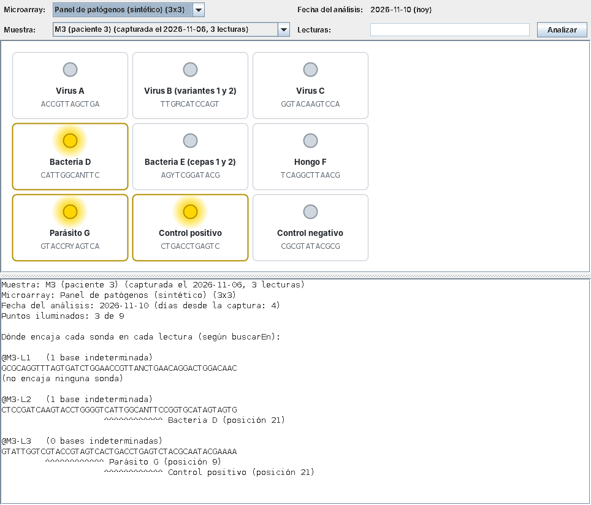
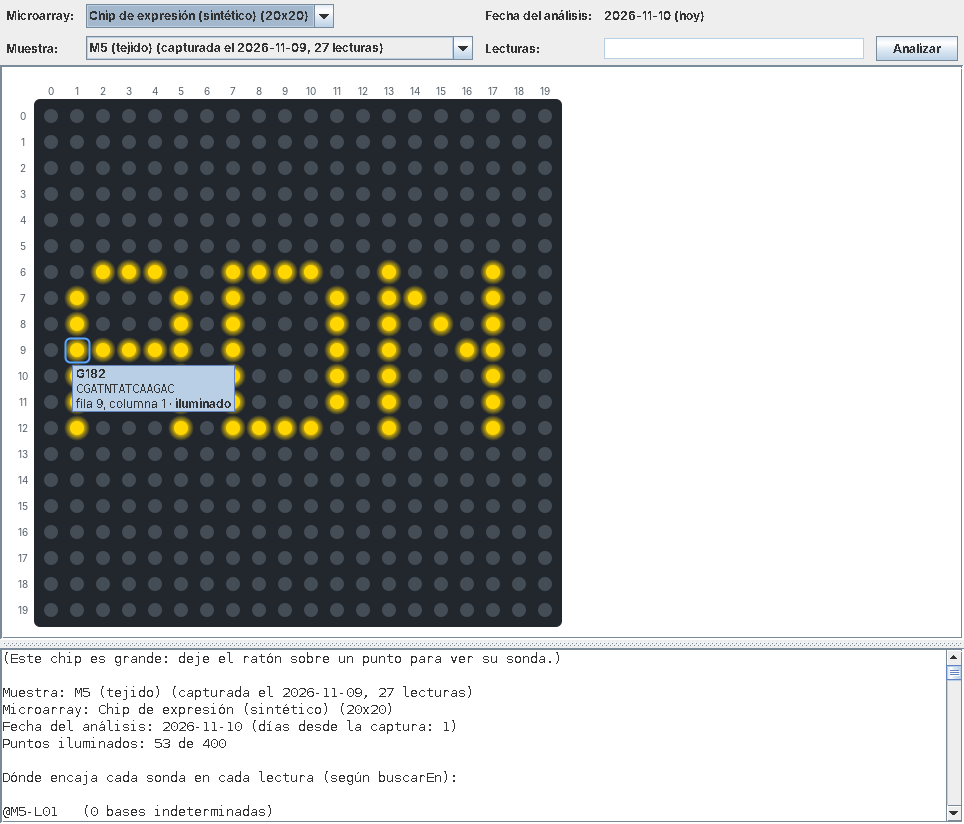

<br/><br/>
<br/><br/>

# Práctica 2: Reconocimiento de patrones en secuencias de ADN

## Contenido

- [Práctica 2: Reconocimiento de patrones en secuencias de ADN](#práctica-2-reconocimiento-de-patrones-en-secuencias-de-adn)
  - [Contenido](#contenido)
  - [Introducción](#introducción)
    - [Contexto de la práctica](#contexto-de-la-práctica)
    - [Patrones con comodines](#patrones-con-comodines)
    - [Modelo del dominio](#modelo-del-dominio)
    - [Organización del proyecto](#organización-del-proyecto)
  - [Objetivos](#objetivos)
  - [Requisitos previos](#requisitos-previos)
  - [Temas relacionados con la práctica](#temas-relacionados-con-la-práctica)
  - [Actividades de la práctica](#actividades-de-la-práctica)
    - [Crear el proyecto en Eclipse](#crear-el-proyecto-en-eclipse)
    - [1. Explorar el proyecto](#1-explorar-el-proyecto)
    - [2. Contar las bases indeterminadas de una lectura](#2-contar-las-bases-indeterminadas-de-una-lectura)
    - [3. Completar la clase `Sonda`](#3-completar-la-clase-sonda)
    - [4. Completar la clase `Microarray`](#4-completar-la-clase-microarray)
    - [5. Completar la clase `Analisis`](#5-completar-la-clase-analisis)
    - [6. Probar el sistema completo](#6-probar-el-sistema-completo)
    - [Exportar el proyecto](#exportar-el-proyecto)
  - [Evaluación](#evaluación)


## Introducción

### Contexto de la práctica

En la práctica 1 programamos las piezas más pequeñas del microarray virtual: funciones que trabajaban con una base, con una posición de una secuencia o con un codón. En esta segunda práctica daremos el paso siguiente: **recorreremos secuencias completas** para buscar en ellas patrones, y organizaremos el programa en **clases** que representan los elementos del experimento.

Cuando se analiza una muestra, el secuenciador obtiene miles de fragmentos cortos de su ADN, llamados **lecturas**, y los guarda en un fichero de texto con formato FASTQ, una lectura tras otra. En esta práctica, cada lectura será una cadena de bases (por ejemplo, `GATTACAGCTTAGC`) con un identificador. Algunas posiciones pueden contener la letra `N`, con la que el secuenciador indica que no ha podido determinar la base.

Un **microarray** es un chip con miles de **sondas** ordenadas en una cuadrícula. Cada sonda reconoce los fragmentos de la muestra que contienen su *diana*, una secuencia corta característica de un patógeno o de un gen. Cuando un fragmento contiene la diana de una sonda, se une a ella (*hibrida*) y ese punto del chip se ilumina. En nuestro microarray virtual, cada sonda guarda directamente el **patrón** de su diana, tal como aparece en las lecturas, y lo busca en cada lectura de la muestra comparando base a base.

Además, cada análisis registra sus **datos de procedencia**: la fecha en que se capturó la muestra y la fecha en que se analizó, que es siempre la del día en que se hace el análisis (la fecha actual).

### Patrones con comodines

Las sondas pueden ser **degeneradas**: su patrón puede contener comodines que encajan con varias bases. Así, una misma sonda puede detectar, por ejemplo, las variantes de un virus que se diferencian en una posición conocida. Usaremos tres de los símbolos del código de ambigüedad de la IUPAC, que es la notación habitual en bioinformática:

| Símbolo del patrón | Encaja con estas bases de la lectura |
|:---:|---|
| `A`, `C`, `G` o `T` | Solo con la misma base |
| `N` | Con cualquier base, incluida una `N` |
| `R` (purina) | Con `A` o con `G` |
| `Y` (pirimidina) | Con `C` o con `T` |

Una `N` de la **lectura** es una base desconocida: no se puede asegurar que coincida con ninguna base concreta del patrón, así que solo encaja con el comodín `N`. Por ejemplo, el patrón `GAYTRCA` encaja con las lecturas `GATTACA` y `GACTGCA`, pero no con `GATNACA`.

Las lecturas solo pueden contener `A`, `C`, `G`, `T` y `N`, y los patrones, además, `R` e `Y`. Cualquier otro carácter (una letra minúscula, una `U`, un espacio…) no es válido: las clases de la práctica lo rechazan lanzando una excepción.

> [!NOTE]
> Estos comodines se usan en la práctica real: por ejemplo, la enzima de restricción HincII corta el ADN allí donde encuentra la secuencia `GTYRAC`. Uno de los microarrays de ejemplo de la práctica contiene las secuencias que reconocen ocho de estas enzimas.

### Modelo del dominio

El siguiente diagrama resume las clases de la práctica, con sus atributos, sus métodos y sus relaciones. En cada clase se indica qué métodos se proporcionan ya hechos y cuáles debe completar usted:

````mermaid
classDiagram
direction LR

class Iupac {
<<utilidades>>
+esSimboloDeLectura(char) boolean$
+esSimboloDePatron(char) boolean$
+esPurina(char) boolean$
+esPirimidina(char) boolean$
+complementario(char) char$
}

class Lectura {
-id: String
-secuencia: String
……………Proporcionados……………()
+Lectura(String, String)
+getId() String
+getSecuencia() String
+getLongitud() int
+getBase(int) char
+toString() String
……………A completar……………()
+contarIndeterminadas() int
}

class Muestra {
-id: String
-fechaCaptura: LocalDate
-lecturas: Lectura[]
……………Proporcionados……………()
+Muestra(String, LocalDate, Lectura[])
+getId() String
+getFechaCaptura() LocalDate
+getNumeroLecturas() int
+getLectura(int) Lectura
+getLecturas() Lectura[]
+toString() String
}

class Sonda {
-nombre: String
-patron: String
……………A completar……………()
+Sonda(String, String)
+getNombre() String
+getPatron() String
+getLongitud() int
+encaja(char, char) boolean$
+encajaEn(Lectura, int) boolean
+buscarEn(Lectura) int
+hibridaCon(Lectura) boolean
……………Proporcionados……………()
+toString() String
}

class Microarray {
-nombre: String
-sondas: Sonda[][]
……………Proporcionados……………()
+Microarray(String, Sonda[][])
+getNombre() String
+getFilas() int
+getColumnas() int
+getSonda(int, int) Sonda
+toString() String
……………A completar……………()
+hibridar(Lectura) boolean[][]
+hibridar(Muestra) boolean[][]
}

class Analisis {
-muestra: Muestra
-microarray: Microarray
-fechaAnalisis: LocalDate
-iluminados: boolean[][]
……………A completar……………()
+Analisis(Muestra, Microarray)
+getMuestra() Muestra
+getMicroarray() Microarray
+getFechaAnalisis() LocalDate
+getIluminados() boolean[][]
+getDiasDesdeCaptura() long
+contarIluminados() int
……………Proporcionados……………()
+toString() String
}

Muestra *-- Lectura : lecturas
Microarray *-- Sonda : sondas
Analisis --> Muestra
Analisis --> Microarray
Sonda ..> Lectura : busca su patrón en
Sonda ..> Iupac
Lectura ..> Iupac
````

### Organización del proyecto

A diferencia de la práctica 1, el código se organiza en **clases**, dentro del paquete `es.upm.dit.fprg26.p2`. Cada clase está en su propio fichero, y cualquier clase del proyecto puede usar las demás.

| Elementos | Qué son | Qué debe hacer usted |
|---|---|---|
| `BaseNitrogenada`, `AcidoNucleico` | Los enumerados de la práctica 1 | Nada: se usan desde `Iupac` |
| `Iupac` | Métodos de utilidad (estáticos) sobre los símbolos de lecturas y patrones | Usarlos, leyendo su documentación |
| `Lectura`, `Muestra` | Una lectura y una muestra con sus lecturas, ya programadas | Estudiarlas (son un buen modelo de clase) y completar `contarIndeterminadas` |
| `Sonda`, `Microarray`, `Analisis` | Las clases del reconocimiento de patrones | Completar los métodos que se indican en cada apartado |
| `PruebaLectura`, `PruebaSonda`, `PruebaMicroarray`, `PruebaAnalisis` | Pruebas de cada clase, con una muestra de casos | Ejecutarlas y añadir sus propios casos de prueba |
| `PruebaInteractiva` | Programa que abre la ventana del microarray virtual | Ejecutarlo al final, y añadir sus propios microarrays y muestras |
| Paquete `auxiliar` | Datos de ejemplo, comprobaciones de las pruebas y ventana gráfica | Usarlo (**no es necesario entender el código de la ventana, ni mucho menos modificarlo**) |
| Carpeta `doc` | Documentación de todo el proyecto, en HTML (generada con Javadoc) | Consultarla con el navegador |

Para usar las clases de la biblioteca de Java, como `LocalDate`, las clases empiezan con una **importación de módulo**: `import module java.base;` importa de una vez todos los paquetes del módulo básico de Java (`java.util`, `java.time`, etc.).

> [!WARNING]
> No modifique las cabeceras de los métodos que se proporcionan, ni añada más atributos a las clases que completa: sus atributos ya están declarados (puede declararlos `final`, porque no cambian después de crear el objeto).

## Objetivos

- Construir clases: atributos, constructores que validan sus datos y lanzan excepciones, métodos de acceso y otros métodos.
- Recorrer cadenas de caracteres y arrays (de una y de dos dimensiones) con bucles, incluidos bucles anidados.
- Aplicar un algoritmo de búsqueda de patrones con comodines (ventana deslizante).
- Capturar excepciones con `try`/`catch`.
- Usar clases de la biblioteca de Java para trabajar con fechas (`LocalDate`, `ChronoUnit`).
- Desarrollar código a partir de su especificación en Javadoc, y probarlo con sus propios casos de prueba.

## Requisitos previos

- Disponer de un entorno de desarrollo que permita desarrollar programas en Java 25. Las indicaciones de este enunciado se refieren a **Eclipse 2025-12 (4.38) o posterior**, con un **JDK 25** instalado.

## Temas relacionados con la práctica

Los temas del curso dedicados a las clases y los objetos (atributos, constructores y métodos), las estructuras de control repetitivas (bucles), los arrays, las cadenas de caracteres y las excepciones.

## Actividades de la práctica

### Crear el proyecto en Eclipse

En Eclipse debe seguir los siguientes pasos:

- Descargue de GitHub pulsando sobre el botón _Code ⇾ Download ZIP_ el fichero zip que encontrará en la entrada _Práctica 2 - Main_.
- Importe el proyecto con _File ➤ Import ➤ General ➤ Existing Projects into Workspace_ e indique la localización del fichero zip descargado usando la opción _Select archive file_.
- El proyecto está configurado para Java 25 (_JavaSE-25_). Si Eclipse indica que no encuentra ese entorno, añada su JDK 25 en _Window ➤ Preferences ➤ Java ➤ Installed JREs_.
- Todas las clases están en la carpeta _src_, en el paquete `es.upm.dit.fprg26.p2` (y el código auxiliar, en `es.upm.dit.fprg26.p2.auxiliar`).
- Para ejecutar un programa, pulse con el botón derecho sobre el fichero (por ejemplo, `PruebaSonda.java`) y elija _Run As ➤ Java Application_.

### 1. Explorar el proyecto

**Pasos:**

1. Abra la documentación del proyecto en el navegador: pulse con el botón derecho sobre `doc/index.html` y elija _Open With ➤ Web Browser_. Lea la de la clase `Iupac`: le servirá en toda la práctica.
2. Estudie las clases `Lectura` y `Muestra`, que se proporcionan ya programadas. Fíjese en cómo están construidas, porque las clases que completará usted siguen el mismo modelo:
   - sus **atributos** son privados y `final`;
   - el **constructor** comprueba que los datos son válidos y, si no lo son, lanza una excepción con un mensaje que explica el motivo. Por ejemplo, el de `Lectura` recorre la secuencia con un bucle para comprobar cada carácter;
   - los **métodos de acceso** (`getId`, `getSecuencia`…) devuelven los atributos o datos calculados a partir de ellos;
   - `getBase` lanza una excepción si se le pide una posición que está fuera de la lectura.
3. Fíjese en cómo se trabaja con fechas en `Muestra`: la fecha de captura es un `LocalDate`, y el constructor comprueba con `isAfter` que no es posterior a la fecha actual (`LocalDate.now()`). Puede consultar todos sus métodos en la [documentación de `LocalDate`](https://docs.oracle.com/en/java/javase/25/docs/api/java.base/java/time/LocalDate.html).
4. Ejecute `PruebaInteractiva`. Se abrirá la ventana del microarray virtual, aunque todavía no funcionará: sus sondas aparecerán como `(null)` y no se iluminará ningún punto. Al terminar la práctica, funcionará por completo.

> [!IMPORTANT]
> **Sus propios casos de prueba.** Cada clase de prueba (`PruebaSonda`, etc.) comprueba una **muestra** de casos y escribe `✓` o `✗` en cada comprobación, con el resultado esperado y el obtenido. Aunque todas sus comprobaciones sean correctas, eso no garantiza que su código lo sea. Por eso, cada clase de prueba tiene un método `pruebasPropias`, donde debe añadir sus propios casos. Puede usar el mismo método que las pruebas proporcionadas:
> ```java
> Comprobador.comprobar("buscarEn en una lectura sin la diana", -1, sonda.buscarEn(lectura));
> ```
> Para comprobar que un constructor lanza una excepción, invóquelo dentro de un bloque `try`: si no la lanza, llame a `Comprobador.fallo(...)`; en el `catch`, a `Comprobador.acierto(...)` (vea `PruebaSonda`).

### 2. Contar las bases indeterminadas de una lectura

Empezaremos con un recorrido sencillo de una cadena de caracteres. En la clase `Lectura`, complete el método **`contarIndeterminadas`**, que devuelve cuántas posiciones de la lectura contienen la base indeterminada `N` (por ejemplo, la lectura `GANTACNA` tiene 2). Recorra la secuencia con un bucle y use la constante `Iupac.INDETERMINADA`.

Ejecute `PruebaLectura` y corrija lo que sea necesario hasta que todas las comprobaciones aparezcan con `✓`. Después, añada sus propios casos de prueba.

### 3. Completar la clase `Sonda`

La clase `Sonda` representa una sonda del microarray: su nombre y el patrón de su diana, que puede contener comodines. Esta es la clase central de la práctica: contiene el algoritmo de reconocimiento de patrones.

**Pasos:**

1. **Constructor**: compruebe que el nombre no es nulo ni está en blanco, y que el patrón no es nulo ni vacío y solo contiene símbolos de patrón (use `Iupac.esSimboloDePatron` con cada carácter). Si algún dato no es válido, lance una excepción con un mensaje que explique el motivo; si todos lo son, asigne los atributos. Tome como modelo el constructor de `Lectura`.
2. **Métodos de acceso**: `getNombre`, `getPatron` y `getLongitud` (la longitud del patrón).
3. **`encaja(char simbolo, char base)`**: indica si un símbolo del patrón encaja con una base de la lectura, según la tabla de los [patrones con comodines](#patrones-con-comodines). Primero, compruebe que el símbolo es un símbolo de patrón y la base, un símbolo de lectura (con `Iupac.esSimboloDePatron` e `Iupac.esSimboloDeLectura`); si alguno no lo es, lance una excepción. Después, use una sentencia `switch` con un caso para cada comodín y un caso `default` para las bases. Puede apoyarse en `Iupac.esPurina` e `Iupac.esPirimidina`. Es un método **estático**: no depende de ninguna sonda concreta, y se invoca con el nombre de la clase (`Sonda.encaja('R', 'G')`).
4. **`encajaEn(Lectura lectura, int inicio)`**: indica si el patrón encaja con la lectura colocando su primer símbolo en la posición `inicio` de la lectura. Recorra el patrón con un bucle: el símbolo `i` del patrón se compara con la base `inicio + i` de la lectura, que puede obtener con `lectura.getBase(...)`. En cuanto un símbolo no encaje, el patrón no encaja.

   `getBase` lanza una excepción si la posición está fuera de la lectura, así que el patrón no cabe en ella a partir de esa posición. Capture esa excepción con un bloque `try`/`catch`: en ese caso, `encajaEn` debe devolver `false`. El mismo bloque captura también las excepciones de `encaja`, que no deberían producirse, porque los constructores de `Sonda` y de `Lectura` ya comprueban sus caracteres.
5. **`buscarEn(Lectura lectura)`**: devuelve la primera posición de la lectura a partir de la cual encaja el patrón, o `-1` si no encaja en ninguna. Es el algoritmo de la **ventana deslizante**: se coloca el patrón al principio de la lectura y se va desplazando una posición cada vez, comprobando en cada una si encaja (con `encajaEn`). Por ejemplo, para buscar el patrón `TRC` en la lectura `GATACATGCA`:

   ```
   GATACATGCA
   TRC            posición 0: T no encaja con G
    TRC           posición 1: T no encaja con A
     TRC          posición 2: T con T, R con A, C con C → encaja: devuelve 2
   ```

   ¿Cuál es la última posición en la que tiene sentido colocar el patrón? Piense en un patrón de 3 símbolos y una lectura de 10 bases.
6. **`hibridaCon(Lectura lectura)`**: indica si el patrón aparece en algún lugar de la lectura. Reutilice `buscarEn`.
7. Ejecute `PruebaSonda` y corrija lo que sea necesario hasta que todas las comprobaciones aparezcan con `✓`. Después, añada sus propios casos de prueba: por ejemplo, patrones al principio y al final de la lectura, patrones que aparecen varias veces, lecturas con `N` y patrones más largos que la lectura.

> [!TIP]
> Antes de programar `buscarEn`, dibuje a mano una lectura y un patrón, y vaya desplazando el patrón posición a posición. Le ayudará a encontrar el límite del bucle, que es donde suelen estar los errores.

### 4. Completar la clase `Microarray`

La clase `Microarray` representa un chip con sondas en una cuadrícula: una matriz `Sonda[][]`, en la que `sondas[fila][columna]` es la sonda de cada punto. El constructor y los métodos de acceso se proporcionan hechos (fíjese en cómo el constructor recorre la matriz con dos bucles anidados para validarla).

**Pasos:**

1. **`hibridar(Lectura lectura)`**: devuelve una matriz de `boolean` del mismo tamaño que la cuadrícula, con `true` en los puntos cuya sonda hibrida con la lectura. Cree la matriz con `new boolean[filas][columnas]` y recórrala con dos bucles anidados.
2. **`hibridar(Muestra muestra)`**: hace lo mismo con todas las lecturas de la muestra. Un punto se ilumina si su sonda hibrida con **alguna** de las lecturas. Puede recorrer las lecturas con un bucle `for` mejorado (`for (Lectura lectura : muestra.getLecturas())`) y reutilizar el método anterior. Cuidado: un punto que ya se ha iluminado con una lectura no debe apagarse porque no hibride con la siguiente.
3. Ejecute `PruebaMicroarray` y corrija lo que sea necesario. Las matrices se escriben con `#` para los puntos iluminados y `.` para los apagados, una fila entre corchetes (las grandes, una fila en cada línea). Fíjese en la prueba con el chip de 2x4: si confunde filas y columnas, fallará. La última prueba usa un chip de 20x20 sondas: si su código es correcto, los puntos iluminados forman una palabra.

### 5. Completar la clase `Analisis`

La clase `Analisis` representa el resultado de analizar una muestra con un microarray. Como en un laboratorio, el análisis se registra en el momento en que se hace: su fecha es la fecha actual.

**Pasos:**

1. **Constructor**: compruebe que ningún parámetro es nulo; si alguno lo es, lance una excepción. Después, asigne los atributos: la fecha del análisis es la fecha actual, que se obtiene con `LocalDate.now()`, y los puntos iluminados se calculan con `hibridar(Muestra)`. No hace falta comprobar que la fecha del análisis no es anterior a la de captura: `Muestra` no admite fechas de captura futuras.
2. **Métodos de acceso**: `getMuestra`, `getMicroarray`, `getFechaAnalisis` y `getIluminados`.
3. **`getDiasDesdeCaptura`**: devuelve cuántos días han pasado entre la captura de la muestra y el análisis. Use `ChronoUnit.DAYS.between(fechaInicial, fechaFinal)`, que tiene en cuenta los meses de distinta duración y los años bisiestos. Como el análisis siempre es de hoy, las fechas de captura de las muestras de ejemplo son relativas a la fecha actual (de 1 a 6 días antes), y las pruebas crean muestras capturadas hace 0, 40 y 400 días.
4. **`contarIluminados`**: devuelve cuántos puntos del chip se han iluminado.
5. Ejecute `PruebaAnalisis` y corrija lo que sea necesario. Después, añada sus propios casos de prueba.

### 6. Probar el sistema completo

Ejecute de nuevo `PruebaInteractiva`. Elija un microarray y una muestra (o escriba sus propias lecturas, separadas por espacios) y pulse _Analizar_: los puntos del chip cuyas sondas hibridan con alguna lectura se iluminarán, y debajo verá, para cada lectura, en qué posición encaja cada sonda (según su método `buscarEn`).



**Pasos:**

1. Analice cada muestra de ejemplo con el panel de patógenos y compruebe que el resultado es el esperado según la [tabla de los comodines](#patrones-con-comodines). Por ejemplo, en la muestra M3, la lectura M3-L1 contiene la diana del Virus A con una `N` en una posición sin comodín, así que esa sonda no se ilumina; en cambio, la diana de la Bacteria D tiene la `N` en la posición del comodín y sí se ilumina.
2. Fíjese en las sondas de control: la de control positivo detecta una secuencia que está en todas las muestras de pacientes, y la de control negativo no debería iluminarse nunca. En un chip real sirven para comprobar que el análisis se ha hecho correctamente.
3. Elija el **chip de expresión**, de 20x20 sondas, y analice con él la muestra M5. Es más parecido a un chip real: tiene tantas sondas que no se escriben sus nombres ni sus patrones; para ver los de una sonda, deje el ratón sobre su punto. ¿Qué palabra forman los puntos iluminados?

   

4. Añada en el método `main` de `PruebaInteractiva` sus propios microarrays y muestras (encontrará un ejemplo), y compruebe que el resultado es el que espera.

### Exportar el proyecto

- En Eclipse: _File ➤ Export ➤ General ➤ Archive File_, seleccionar el proyecto, elegir destino y formato ZIP, y finalizar para generar el archivo exportado de la práctica.
- Verificar el ZIP y, si se desea reimportar para comprobar su integridad, emplear _File ➤ Import ➤ General ➤ Existing Projects into Workspace_ con la opción _Select archive file_.

## Evaluación

La evaluación se realizará mediante una prueba escrita individual centrada en la aplicación de los conceptos trabajados (clases, constructores con validación, bucles, recorridos de cadenas y arrays, excepciones, fechas y pruebas), con ejercicios similares a los desarrollados durante la práctica. Por ejemplo, se le podrá pedir que:
- desarrolle un nuevo método a partir de su documentación;
- modifique o amplíe alguna de las clases de la práctica;
- prediga el resultado de una invocación, o localice y corrija un error en un método;
- escriba las pruebas de un método.
