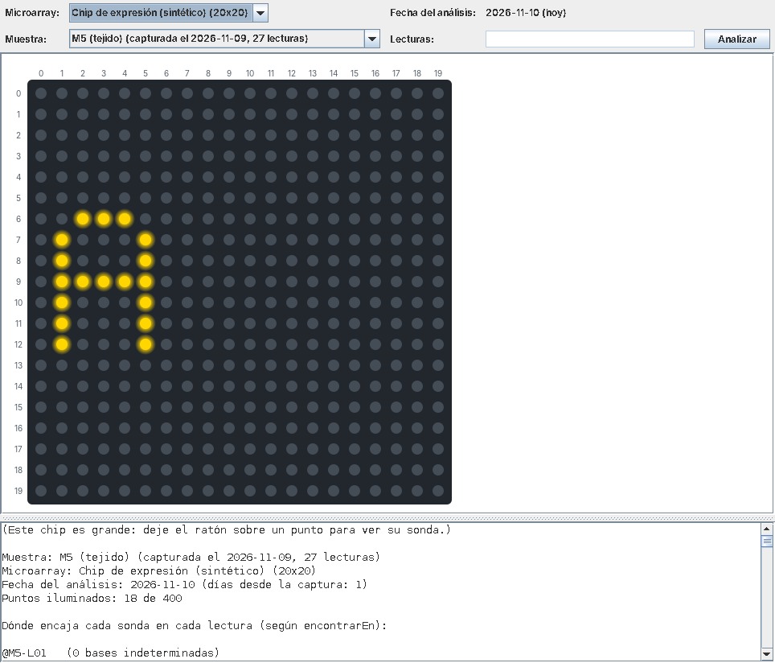

<br/><br/>
<br/><br/>

# Práctica 2: Reconocimiento de patrones en secuencias de ADN

## Contenido

- [Práctica 2: Reconocimiento de patrones en secuencias de ADN](#práctica-2-reconocimiento-de-patrones-en-secuencias-de-adn)
  - [Contenido](#contenido)
  - [Introducción](#introducción)
    - [Contexto de la práctica](#contexto-de-la-práctica)
    - [Búsqueda de patrones](#búsqueda-de-patrones)
    - [Patrones con comodines](#patrones-con-comodines)
    - [Las dos hebras](#las-dos-hebras)
    - [Modelo del dominio](#modelo-del-dominio)
    - [Organización del proyecto](#organización-del-proyecto)
  - [Objetivos](#objetivos)
  - [Requisitos previos](#requisitos-previos)
  - [Temas relacionados con la práctica](#temas-relacionados-con-la-práctica)
  - [Actividades de la práctica](#actividades-de-la-práctica)
    - [Crear el proyecto en Eclipse](#crear-el-proyecto-en-eclipse)
    - [1. Explorar el proyecto](#1-explorar-el-proyecto)
    - [2. Empezar la clase `Sonda`](#2-empezar-la-clase-sonda)
    - [3. Completar la clase `Microarray`](#3-completar-la-clase-microarray)
    - [4. Reconocer patrones con comodines](#4-reconocer-patrones-con-comodines)
    - [5. Buscar en las dos hebras](#5-buscar-en-las-dos-hebras)
    - [6. Probar el sistema completo](#6-probar-el-sistema-completo)
    - [Exportar el proyecto](#exportar-el-proyecto)
  - [Evaluación](#evaluación)


## Introducción

### Contexto de la práctica

En la práctica 1 habíamos programado las piezas más pequeñas del microarray virtual: funciones que trabajaban con una base, con una posición de una secuencia o con un codón. En esta segunda práctica daremos el paso siguiente: **recorreremos secuencias completas** para **buscar en ellas patrones**, y organizaremos el programa en **clases** que representan los elementos del experimento.

Cuando se va a analizar una muestra de ADN, el secuenciador obtiene miles de fragmentos cortos de ADN llamados **lecturas**, y los guarda en un fichero de texto con formato FASTQ, una lectura tras otra. En esta práctica, cada lectura será una cadena (`String`) de bases (por ejemplo, `GATTACAGCTTAGC`) con un identificador. También es posible que algunas posiciones contengan la letra `N`, con la que el secuenciador indica que no ha podido determinar la base.

Un **microarray** es un chip con miles de **sondas** ordenadas en una cuadrícula. Cada sonda está diseñada para encontrar en las muestras de ADN una secuencia corta llamada *diana*, característica de un patógeno o de un gen. Cuando un fragmento contiene la diana de una sonda, se une a ella (se *hibrida*) y ese punto del chip se ilumina. En nuestro microarray virtual, cada sonda guarda directamente el **patrón** de su diana, tal como aparece en las lecturas.

Además, cada análisis registrará sus **datos de procedencia**: la fecha en que se capturó la muestra y la fecha en que se analizó, que es siempre la del día en que se hace el análisis (la fecha actual).

### Búsqueda de patrones

Para saber si una sonda hibrida con una lectura, se busca su patrón en la lectura. Se coloca el patrón bajo la lectura, a partir de una posición, y se compara cada símbolo del patrón con la base que tiene encima: si todos coinciden, el patrón **encaja** en esa posición; si no, se prueba en la siguiente. La sonda hibrida con la lectura si su patrón encaja en alguna posición.

Por ejemplo, el patrón `CAGCT` encaja en la lectura `GATTACAGCTTAGC` a partir de la posición 5 (las posiciones se cuentan desde 0, como en un `String`):

```
posición  01234567890123
lectura   GATTACAGCTTAGC
patrón         CAGCT
```

En cambio, no encaja en ninguna posición de la lectura `GATTACAGGTTAGC`: basta con que una base no coincida (aquí, la `G` de la posición 8, bajo la que queda la segunda `C` del patrón) para que el patrón no encaje.

### Patrones con comodines

Las sondas también pueden ser **degeneradas**: su patrón puede contener comodines, que encajan con varias bases. Así, una misma sonda puede detectar, por ejemplo, las variantes de un virus que se diferencian en una posición conocida. Usaremos tres de los símbolos del código de ambigüedad de la IUPAC, que es la notación habitual en bioinformática:

| Símbolo del patrón | Encaja con estas bases de la lectura |
|:---:|---|
| `A`, `C`, `G` o `T` | Solo con la misma base |
| `N` | Con cualquier base, incluida una `N` |
| `R` (purina) | Con `A` o con `G` |
| `Y` (pirimidina) | Con `C` o con `T` |

Por ejemplo, el patrón `CAGYT` encaja a partir de la posición 5 tanto en la lectura `GATTACAGCTTAGC` (la `Y` con una `C`) como en `GATTACAGTTTAGC` (la `Y` con una `T`): una sola sonda detecta las dos variantes.

En cambio, una `N` de la **lectura** es una base desconocida: no se puede asegurar que coincida con ninguna base concreta del patrón, así que solo encaja con el comodín `N`. Por ejemplo, en la lectura `GATTACANCTTAGC` se desconoce la base de la posición 7: el patrón `CAGYT` no encaja, porque no se puede asegurar que esa base sea una `G`, pero `CANYT` sí.

Las lecturas solo pueden contener `A`, `C`, `G`, `T` y `N`, y los patrones, además, `R` e `Y`. Cualquier otro carácter no es válido: las clases de la práctica lo rechazan lanzando una excepción.

> [!NOTE]
> Estos comodines se usan en la práctica real: por ejemplo, la enzima de restricción HincII corta el ADN allí donde encuentra la secuencia `GTYRAC`. Uno de los microarrays de ejemplo de la práctica contiene las secuencias que reconocen ocho de estas enzimas.

### Las dos hebras

El ADN tiene dos hebras complementarias: frente a cada `A` de una hebra hay una `T` en la otra, y frente a cada `C`, una `G` (y al revés). Cada lectura procede de una de las dos hebras, sin que se sepa de cuál. Si procede de la hebra contraria a la de la diana, no contiene la diana tal cual, sino su **complementaria inversa**: la secuencia de la otra hebra, leída en el mismo sentido que las lecturas. Se obtiene recorriendo la diana de derecha a izquierda y sustituyendo cada base por su complementaria. Por ejemplo, la complementaria inversa de `CAGCT` es `AGCTG`:

```
diana                        CAGCT
de derecha a izquierda       TCGAC
complementaria de cada base  AGCTG
```

Por eso, el patrón de una sonda se busca en los dos sentidos. En **sentido directo**, como se ha explicado antes. En **sentido inverso**, se compara el patrón, leído de derecha a izquierda, con las complementarias de las bases de la lectura. Por ejemplo, el patrón `CAGCT` encaja en sentido inverso en la lectura `GATTAGCTGTTAGC` a partir de la posición 4:

```
posición                   01234567890123
lectura                    GATTAGCTGTTAGC
complementarias                TCGAC
patrón, de derecha a izq.      TCGAC
```

Los símbolos del patrón se comparan con las complementarias igual que en sentido directo, así que los comodines funcionan en los dos sentidos: por ejemplo, `CAGYT` encaja en sentido inverso en la lectura `GATTAACTGTTAGC`.

### Modelo del dominio

El siguiente diagrama resume las clases de la práctica, con sus atributos, sus métodos y sus relaciones. En cada clase se indica qué métodos se proporcionan ya hechos y cuáles debe completar o modificar usted:

````mermaid
classDiagram
direction LR

class Lectura {
-id: String
-secuencia: String
……………Proporcionados……………()
Lectura(String, String)
getId() String
getSecuencia() String
getLongitud() int
getBase(int) char
esSimboloValido(char) boolean$
complementaria(char) char$
toString() String
}

class Muestra {
-id: String
-fechaCaptura: LocalDate
-lecturas: Lectura[]
……………Proporcionados……………()
Muestra(String, LocalDate, Lectura[])
getId() String
getFechaCaptura() LocalDate
getNumeroLecturas() int
getLectura(int) Lectura
getLecturas() Lectura[]
toString() String
}

class Sonda {
-nombre: String
-patron: String
……………A completar……………()
Sonda(String, String)
encaja(char, char) boolean$
encajaInverso(char, char) boolean$
encajaEn(Lectura, int) boolean
hibridaCon(Lectura) boolean
……………A modificar……………()
encontrarEn(Lectura) int
……………Proporcionados……………()
esSimboloValido(char) boolean$
getNombre() String
getPatron() String
getLongitud() int
toString() String
}

class Microarray {
-nombre: String
-sondas: Sonda[][]
……………Proporcionados……………()
Microarray(String, Sonda[][])
getNombre() String
getFilas() int
getColumnas() int
getSonda(int, int) Sonda
hibridar(Lectura) boolean[][]
toString() String
……………A completar……………()
hibridar(Muestra) boolean[][]
}

class Analisis {
-muestra: Muestra
-microarray: Microarray
-fechaAnalisis: LocalDate
-iluminados: boolean[][]
……………Proporcionados……………()
Analisis(Muestra, Microarray)
getMuestra() Muestra
getMicroarray() Microarray
getFechaAnalisis() LocalDate
getIluminados() boolean[][]
getDiasDesdeCaptura() long
contarIluminados() int
toString() String
}

Muestra *-- Lectura : lecturas
Microarray *-- Sonda : sondas
Analisis --> Muestra
Analisis --> Microarray
Sonda ..> Lectura : busca su patrón en
````

### Organización del proyecto

A diferencia de la práctica 1, el código se organiza en **clases**, dentro del paquete `es.upm.dit.fprg26.p2`. Cada clase está en su propio fichero, y cualquier clase del proyecto puede usar las demás.

| Elementos | Qué son | Qué debe hacer usted |
|---|---|---|
| `Lectura`, `Muestra`, `Analisis` | Una lectura, una muestra con sus lecturas y el resultado de analizar una muestra con un microarray, ya programadas | Estudiarlas (son un buen modelo de clase) |
| `Sonda`, `Microarray` | Las clases del reconocimiento de patrones | Completar los métodos que se indican en cada apartado |
| `PruebaSonda`, `PruebaMicroarray` | Pruebas de cada clase, con una muestra de casos | Ejecutarlas y añadir sus propios casos de prueba |
| `PruebaInteractiva` | Programa que abre la ventana del microarray virtual | Ejecutarlo al final, y añadir sus propios microarrays y muestras |
| Carpeta `auxiliar` (en el mismo paquete) | Datos de ejemplo (`DatosEjemplo`), comprobaciones de las pruebas (`Comprobador`) y ventana gráfica | Usarlo (**no es necesario entender el código de la ventana, ni mucho menos modificarlo**) |
| Carpeta `doc` | Documentación de todo el proyecto, en HTML (generada con Javadoc) | Consultarla con el navegador |

Para usar las clases de la biblioteca de Java, como `LocalDate`, las clases empiezan con una **importación de módulo**: `import module java.base;` importa de una vez todos los paquetes del módulo básico de Java (`java.util`, `java.time`, etc.).

> [!WARNING]
> No modifique las cabeceras de los métodos que se proporcionan, ni añada más atributos a las clases que completa: sus atributos ya están declarados.

## Objetivos

- Completar clases: constructores que validan sus datos y lanzan excepciones, y métodos que trabajan con sus atributos.
- Recorrer cadenas de caracteres y arrays (de una y de dos dimensiones) con bucles, incluidos bucles anidados.
- Aplicar un algoritmo de búsqueda de patrones con comodines (ventana deslizante).
- Capturar excepciones con `try`/`catch`.
- Comprender el uso de clases de la biblioteca de Java para trabajar con fechas (`LocalDate`, `ChronoUnit`).
- Desarrollar código a partir de su especificación en Javadoc, y probarlo con sus propios casos de prueba.

## Requisitos previos

- Disponer de un entorno de desarrollo que permita desarrollar programas en Java 25. Las indicaciones de este enunciado se refieren a **Eclipse 2025-12 (4.38) o posterior**, con un **JDK 25** instalado.

## Temas relacionados con la práctica

Los temas del curso dedicados a las clases y los objetos (atributos, constructores y métodos), las estructuras de control repetitivas (bucles), los arrays, las cadenas de caracteres y las excepciones.

## Actividades de la práctica

### Crear el proyecto en Eclipse

En Eclipse debe seguir los siguientes pasos:

- Descargue de GitHub pulsando sobre el botón _Code ⇾ Download ZIP_ el fichero zip que encontrará en la entrada _Práctica 2 - Main_.
- Importe el proyecto con _File ➤ Import ➤ General ➤ Existing Projects into Workspace_ e indique la localización del fichero zip descargado usando la opción _Select archive file_.
- El proyecto está configurado para Java 25 (_JavaSE-25_). Si Eclipse indica que no encuentra ese entorno, añada su JDK 25 en _Window ➤ Preferences ➤ Java ➤ Installed JREs_.
- Las clases de la práctica están en la carpeta _src_, en el paquete `es.upm.dit.fprg26.p2`. El código auxiliar está en la carpeta _auxiliar_, en el mismo paquete.
- Para ejecutar un programa, pulse con el botón derecho sobre el fichero (por ejemplo, `PruebaSonda.java`) y elija _Run As ➤ Java Application_.

### 1. Explorar el proyecto

**Pasos:**

1. Abra la documentación del proyecto en el navegador: pulse con el botón derecho sobre `doc/index.html` y elija _Open With ➤ Web Browser_. La consultará a lo largo de toda la práctica.
2. Estudie las clases `Lectura`, `Muestra` y `Analisis`, que se proporcionan ya programadas. Fíjese en cómo están construidas, porque las clases que completará usted siguen el mismo modelo:
   - sus **atributos** son privados;
   - el **constructor** comprueba que los datos son válidos y, si no lo son, lanza una excepción con un mensaje que explica el motivo. Por ejemplo, el de `Lectura` recorre la secuencia con un bucle para comprobar cada carácter;
   - los **métodos de acceso** (`getId`, `getSecuencia`…) devuelven los atributos o datos calculados a partir de ellos;
   - `getBase` lanza una excepción si se le pide una posición que está fuera de la lectura;
   - los métodos estáticos `esSimboloValido` y `complementaria` trabajan con un carácter suelto, no con una lectura concreta: por eso se invocan con el nombre de la clase (por ejemplo, `Lectura.complementaria('G')` devuelve `'C'`);
   - el constructor de `Analisis` hace el análisis completo: obtiene los puntos iluminados con el método `hibridar(Muestra)` de `Microarray`, que programará usted.
3. Fíjese en cómo se trabaja con fechas. En `Muestra`, la fecha de captura es un `LocalDate`, y el constructor comprueba con `isAfter` que no es posterior a la fecha actual (`LocalDate.now()`). En `Analisis`, la fecha del análisis es la actual, y `getDiasDesdeCaptura` calcula los días transcurridos con `ChronoUnit.DAYS.between`, que tiene en cuenta los meses de distinta duración y los años bisiestos. Puede consultar todos los métodos de `LocalDate` en su [documentación](https://docs.oracle.com/en/java/javase/25/docs/api/java.base/java/time/LocalDate.html).
4. Ejecute `PruebaInteractiva`. Se abrirá la ventana del microarray virtual, aunque todavía no funcionará: sus sondas aparecerán como `(null)` y no se iluminará ningún punto. Al terminar la práctica, funcionará por completo.

> [!IMPORTANT]
> **Sus propios casos de prueba.** Cada clase de prueba (`PruebaSonda`, etc.) comprueba una **muestra** de casos y escribe `✓` o `✗` en cada comprobación, con el resultado esperado y el obtenido. Aunque todas sus comprobaciones sean correctas, eso no garantiza que su código lo sea. Por eso, cada clase de prueba tiene un método `pruebasPropias`, donde debe añadir sus propios casos. Puede usar el mismo método que las pruebas proporcionadas:
> ```java
> Comprobador.comprobar("encontrarEn en una lectura sin la diana", -1, sonda.encontrarEn(lectura));
> ```
> Para comprobar que un constructor lanza una excepción, invóquelo dentro de un bloque `try`: si no la lanza, llame a `Comprobador.fallo(...)`; en el `catch`, a `Comprobador.acierto(...)` (vea `PruebaSonda`).

### 2. Empezar la clase `Sonda`

La clase `Sonda` representa una sonda del microarray: su nombre y el patrón de su diana, que puede contener comodines. Esta es la clase central de la práctica: contiene el algoritmo de reconocimiento de patrones. La completará en tres etapas (este apartado y los apartados 4 y 5), y en cada una el microarray reconocerá más dianas.

Se proporciona hecho el método `encontrarEn`, pero con una versión inicial que no tiene en cuenta los comodines ni la otra hebra: tendrá que modificarlo.

> [!TIP]
> En esta clase trabajará con cadenas de caracteres. Le serán útiles estos métodos de `String` (cada enlace lleva a su documentación): [`length()`](https://docs.oracle.com/en/java/javase/25/docs/api/java.base/java/lang/String.html#length()), [`charAt(int)`](https://docs.oracle.com/en/java/javase/25/docs/api/java.base/java/lang/String.html#charAt(int)), [`isEmpty()`](https://docs.oracle.com/en/java/javase/25/docs/api/java.base/java/lang/String.html#isEmpty()), [`isBlank()`](https://docs.oracle.com/en/java/javase/25/docs/api/java.base/java/lang/String.html#isBlank()) e [`indexOf(String)`](https://docs.oracle.com/en/java/javase/25/docs/api/java.base/java/lang/String.html#indexOf(java.lang.String)).

**Pasos:**

1. **Desarrolle el constructor**: compruebe que el nombre no es nulo ni está en blanco, y que el patrón no es nulo ni vacío y solo contiene símbolos de patrón (use con cada carácter el método `esSimboloValido` de la propia clase `Sonda`, que se proporciona hecho). Si algún dato no es válido, lance una excepción con un mensaje que explique el motivo; si todos lo son, asigne los atributos. Tome como modelo el constructor de `Lectura`.
2. **Desarrolle `hibridaCon(Lectura lectura)`**: este método debe devolver si el patrón aparece en algún lugar de la lectura. Reutilice `encontrarEn`, que devuelve la primera posición de la lectura en la que encaja el patrón, o `-1` si no encaja en ninguna.
3. **Pruebe la versión inicial de `encontrarEn`**. Se proporciona con una implementación muy sencilla, `lectura.getSecuencia().indexOf(patron)`: el método [`indexOf`](https://docs.oracle.com/en/java/javase/25/docs/api/java.base/java/lang/String.html#indexOf(java.lang.String)) de `String` busca un texto dentro de otro, pero comparando los caracteres tal cual, así que no entiende los comodines ni busca en la otra hebra. Ejecute `PruebaSonda`: las comprobaciones del grupo «encontrarEn, con patrones sin comodines» deberían aparecer con `✓`; en cambio, fallarán casi todas las demás de `encontrarEn` (por ejemplo, no encuentra `CAGYT` en `GATTACAGTTTAGC`). Es normal: lo resolverá en los apartados 4 y 5.

### 3. Completar la clase `Microarray`

La clase `Microarray` representa un chip con sondas en una cuadrícula: una matriz `Sonda[][]`, en la que `sondas[fila][columna]` es la sonda de cada punto. El constructor, los métodos de acceso y `hibridar(Lectura lectura)` se proporcionan hechos. Estudie este último: devuelve una matriz de `boolean` del mismo tamaño que la cuadrícula, con `true` en los puntos cuya sonda hibrida con la lectura; la crea con `new boolean[getFilas()][getColumnas()]` y la recorre con dos bucles anidados.

**Pasos:**

1. **Desarrolle `hibridar(Muestra muestra)`**: este método debe hacer lo mismo con todas las lecturas de la muestra. Un punto se ilumina si su sonda hibrida con **alguna** de las lecturas. Puede recorrer las lecturas con un bucle `for` mejorado (`for (Lectura lectura : muestra.getLecturas())`) y reutilizar `hibridar(Lectura)` con cada una. Cuidado: un punto que ya se ha iluminado con una lectura no debe apagarse porque no hibride con la siguiente.
2. Ejecute `PruebaMicroarray`. Las matrices se escriben con `#` para los puntos iluminados y `.` para los apagados, una fila entre corchetes. Como su `Sonda` todavía usa la versión inicial de `encontrarEn`, solo algunas comprobaciones serán correctas; entre ellas debe estar la de la **letra A** del chip de expresión, un chip de 20x20 sondas cuyos puntos iluminados forman una palabra. Si no lo es, corrija `hibridar(Muestra)`.
3. Ejecute `PruebaInteractiva`, elija el **chip de expresión** y analice con él la muestra M5. Es más parecido a un chip real: tiene tantas sondas que no se escriben sus nombres ni sus patrones; para ver los de una sonda, deje el ratón sobre su punto. De momento solo se ilumina una letra, la A: sus sondas no tienen comodines, y sus dianas aparecen tal cual en las lecturas. Las demás letras se iluminarán en los apartados siguientes.

   

### 4. Reconocer patrones con comodines

En este apartado, la sonda aprenderá a reconocer patrones con comodines, de momento en sentido directo.

**Pasos:**

1. **Desarrolle `encaja(char simbolo, char base)`**: este método debe devolver si un símbolo del patrón encaja con una base de la lectura, según la tabla de los [patrones con comodines](#patrones-con-comodines). Primero, compruebe que el símbolo es un símbolo de patrón y la base, un símbolo de lectura (con `esSimboloValido` y `Lectura.esSimboloValido`); si alguno no lo es, lance una excepción. Después, use una sentencia `switch` con un caso para cada comodín (`'N'`, `'R'` e `'Y'`) y un caso `default` para las bases. Es un método **estático**: no depende de ninguna sonda concreta, y se invoca con el nombre de la clase (`Sonda.encaja('R', 'G')`).
2. **Desarrolle `encajaEn(Lectura lectura, int inicio)`, de momento solo en sentido directo**: este método debe devolver si el patrón encaja con la lectura colocando su primer símbolo en la posición `inicio` de la lectura. Recorra el patrón con un bucle: el símbolo `i` del patrón se compara (con `encaja`) con la base `inicio + i` de la lectura, que puede obtener con `lectura.getBase(...)`.

   `getBase` lanza una excepción si la posición está fuera de la lectura, así que el patrón no cabe en ella a partir de esa posición. Capture esa excepción con un bloque `try`/`catch`: en ese caso, `encajaEn` debe devolver `false`. El mismo bloque captura también las excepciones de `encaja`.

   > **Pista**: en cuanto un símbolo no encaje, el patrón ya no puede encajar a partir de esa posición, así que no hace falta seguir comparando: devuelva `false` desde dentro del bucle. Un `return` termina el método en ese mismo momento, y con él, el bucle. Si el bucle llega al final sin que falle ningún símbolo, el patrón encaja: devuelva `true` después del bucle.
3. **Modifique `encontrarEn(Lectura lectura)`** para que tenga en cuenta los comodines: en lugar de `indexOf`, use el algoritmo de la **ventana deslizante**. Se coloca el patrón al principio de la lectura y se va desplazando una posición cada vez, comprobando en cada una si encaja (con `encajaEn`); el método devuelve la primera posición en la que encaja, o `-1` si no encaja en ninguna. Por ejemplo, para buscar el patrón `TRC` en la lectura `GATACATGCA`:

   ```
   GATACATGCA
   TRC            posición 0: T no encaja con G
    TRC           posición 1: T no encaja con A
     TRC          posición 2: T con T, R con A, C con C → encaja: devuelve 2
   ```

   ¿Cuál es la última posición en la que tiene sentido colocar el patrón? Piense en un patrón de 3 símbolos y una lectura de 10 bases.
4. Ejecute `PruebaSonda`. Ahora deberían aparecer con `✓` todas las comprobaciones, salvo las de la otra hebra: los grupos «encajaInverso», «encajaEn, en sentido inverso» y «encontrarEn, con la diana en la otra hebra», y la de `hibridaCon` con la diana en la otra hebra.
5. Ejecute `PruebaMicroarray`: ahora también debe ser correcta la comprobación de la **letra D**, cuyas sondas tienen comodines. Analice de nuevo la muestra M5 con el chip de expresión en `PruebaInteractiva`: se iluminan la A y la D.

> [!TIP]
> Antes de modificar `encontrarEn`, dibuje a mano una lectura y un patrón, y vaya desplazando el patrón posición a posición. Le ayudará a encontrar el límite del bucle, que es donde suelen estar los errores.

### 5. Buscar en las dos hebras

Las dianas de las sondas de la letra N están en la otra hebra (consulte la sección [Las dos hebras](#las-dos-hebras)). Para reconocerlas, la sonda tiene que buscar su patrón también en sentido inverso.

**Pasos:**

1. **Desarrolle `encajaInverso(char simbolo, char base)`**: este método debe devolver si un símbolo del patrón encaja con la base **complementaria** de una base de la lectura (la que tiene enfrente en la otra hebra; consulte la sección [Las dos hebras](#las-dos-hebras)). Obtenga la complementaria con `Lectura.complementaria(base)` y reutilice `encaja`.
2. **Modifique `encajaEn` para que funcione en los dos sentidos**. En el mismo bucle, compare también cada base de la lectura con el símbolo correspondiente del patrón leído de derecha a izquierda: la base `inicio + i` de la lectura, con el símbolo `patron.length() - 1 - i` del patrón, usando `encajaInverso`. El método debe devolver `true` si el patrón encaja en alguno de los dos sentidos.

   > **Pista**: ahora ya no puede devolver `false` en cuanto falle un símbolo en sentido directo, porque el patrón todavía podría encajar en sentido inverso (y al revés). Use dos variables `boolean`, `directo` e `inverso`, que empiezan valiendo `true` y pasan a valer `false` en cuanto falla una comparación en ese sentido. Cuando las dos valgan `false`, ya no tiene sentido seguir comparando: salga del bucle con `break`, que termina el bucle, pero no el método. Después del bucle, devuelva si el patrón encaja en alguno de los dos sentidos.
3. Ejecute `PruebaSonda` y `PruebaMicroarray`, y corrija lo que sea necesario hasta que todas las comprobaciones aparezcan con `✓`. Después, añada sus propios casos de prueba: por ejemplo, patrones al principio y al final de la lectura, patrones que aparecen varias veces, lecturas con `N`, patrones más largos que la lectura y dianas en la otra hebra. Analice de nuevo la muestra M5 con el chip de expresión: ahora se ilumina la palabra completa.

### 6. Probar el sistema completo

Ejecute de nuevo `PruebaInteractiva`. Elija un microarray y una muestra (o escriba sus propias lecturas, separadas por espacios) y pulse _Analizar_: los puntos del chip cuyas sondas hibridan con alguna lectura se iluminarán, y debajo verá, para cada lectura, en qué posición encaja cada sonda (según su método `encontrarEn`).


**Pasos:**

1. Analice cada muestra de ejemplo con el panel de patógenos y compruebe que el resultado es el esperado según la [tabla de los comodines](#patrones-con-comodines). Por ejemplo, en la muestra M3, la lectura M3-L1 contiene la diana del Virus A con una `N` en una posición sin comodín, así que esa sonda no se ilumina; en cambio, la diana de la Bacteria D tiene la `N` en la posición del comodín y sí se ilumina.
2. Fíjese en las sondas de control: la de control positivo detecta una secuencia que está en todas las muestras de pacientes, y la de control negativo no debería iluminarse nunca. En un chip real sirven para comprobar que el análisis se ha hecho correctamente.
3. Vuelva a analizar la muestra M5 con el chip de expresión. Deje el ratón sobre algunos puntos de cada letra y compare sus patrones: ¿qué tienen en común los de la A? ¿Y los de la D? Fíjese también, en el texto de debajo, en dónde encaja cada sonda en cada lectura.

   

4. Añada en el método `main` de `PruebaInteractiva` sus propios microarrays y muestras (encontrará un ejemplo), y compruebe que el resultado es el que espera.

### Exportar el proyecto

- En Eclipse: _File ➤ Export ➤ General ➤ Archive File_, seleccionar el proyecto, elegir destino y formato ZIP, y finalizar para generar el archivo exportado de la práctica.
- Verificar el ZIP y, si se desea reimportar para comprobar su integridad, emplear _File ➤ Import ➤ General ➤ Existing Projects into Workspace_ con la opción _Select archive file_.

## Evaluación

La evaluación se realizará mediante una prueba escrita individual centrada en la aplicación de los conceptos trabajados (clases, constructores con validación, bucles, recorridos de cadenas y arrays, excepciones, fechas y pruebas), con ejercicios similares a los desarrollados durante la práctica. Por ejemplo, se le podrá pedir que:
- desarrolle un nuevo método a partir de su documentación;
- modifique o amplíe alguna de las clases de la práctica;
- prediga el resultado de una invocación, o localice y corrija un error en un método;
- escriba las pruebas de un método.
