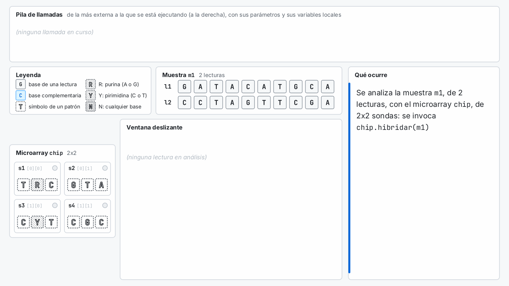

# Animación del algoritmo de la práctica 2

Este proyecto genera una animación que muestra, como un depurador, cómo analiza un microarray una muestra. Se ven las vueltas de cada bucle y las llamadas a `hibridar(Muestra)`, `hibridar(Lectura)`, `hibridaCon`, `encontrarEn`, `encajaEn`, `encaja` y `encajaInverso`, con la ventana deslizante en los dos sentidos. Es el equivalente de la animación del reconocedor de patrones de la P2 de 2025-26 (rama `animated` de `fprg-etsit/Practica2_202526_aux`), adaptado a las lecturas lineales y a las dos hebras de este curso.

> [!NOTE]
> El GIF todavía es el de la primera maquetación: se regenerará cuando se cierre la nueva (falta decidir qué ocupa la franja superior).

## Qué muestra

Cada fotograma es una instantánea del algoritmo de la solución de referencia. La ventana deslizante está en el centro, como en una tabla de doble entrada: las lecturas de la muestra entran desde arriba (alineadas, posición a posición, con la lectura de la ventana) y los patrones del microarray, desde la izquierda (a la altura de las filas del patrón).

| Zona | Contenido |
|------|-----------|
| **Leyenda** (arriba a la izquierda) | Cómo se dibujan las bases, los símbolos de los patrones y los comodines. |
| **Muestra** (arriba) | Las lecturas, con la que se analiza resaltada y las demás atenuadas. |
| **Microarray** (a la izquierda) | Las sondas del chip, con la que se comprueba resaltada. Al final, los puntos iluminados. |
| **Ventana deslizante** (en el centro) | La lectura, sus complementarias y el patrón colocado en la posición `inicio`: debajo de la lectura, en sentido directo, y debajo de las complementarias, de derecha a izquierda, en sentido inverso. Cada símbolo se marca al compararlo (en amarillo) y con el resultado (en verde o en rojo), y encima se indican los valores que toma `inicio` en el bucle de `encontrarEn`. |
| **Pila de llamadas** (a la derecha) | Las llamadas en curso, con el tipo (en gris) y el valor de sus argumentos (`s1.encajaEn(Lectura l1, int 2)`), lo que devuelven cuando terminan y sus variables locales, también con su tipo (`int inicio = 2`). Las matrices de `boolean` se dibujan como cuadrículas de puntos, y en la de `hibridar(Lectura)` se marca el elemento de la sonda que se comprueba. Las variables que cambian dentro de una misma llamada se resaltan en amarillo, como en el depurador de Eclipse. |
| **Mensaje** (abajo) | Qué ocurre en ese paso y por qué (por ejemplo, «`encajaInverso('C', 'G')` devuelve `true`: la complementaria de G es C, y C encaja con C»). |

Las secuencias se dibujan siempre igual, con una casilla por elemento:

- las **bases** de las lecturas (y sus complementarias, en azul), con borde continuo y letra maciza;
- los **símbolos de los patrones**, con borde punteado y letra hueca: el patrón no es una secuencia de bases, sino la plantilla con que se comparan (el borde punteado no se usa para nada más);
- los **comodines**, además, con un fondo rayado: `R` (purina), con rayas en un sentido; `Y` (pirimidina), en el otro; y `N` (cualquier base, purina o pirimidina), en los dos. Así, la `N` de un patrón (comodín) no se confunde con la `N` de una lectura (base desconocida).

Los objetos se nombran como variables, en minúscula (`chip`, `m1`, `l1`, `s1`), y el código y los nombres se escriben en letra monoespaciada, en la que la `l` minúscula no se confunde con el `1` ni con la `I`. Los colores son los de las figuras del enunciado y de la ventana de la práctica.

El ejemplo usa un chip de 2x2 sondas y una muestra de dos lecturas, elegidos para que aparezcan todos los casos:

| Sonda | Patrón | Con `l1` (`GATACATGCA`, la de los ejemplos del enunciado) | Con `l2` (`CCTAGTTCGA`) |
|-------|--------|------|------|
| `s1` | `TRC` | Encaja en sentido directo en la posición 2 (la `R` con una `A`), después de fallar en las posiciones 0 y 1 en los dos sentidos | No encaja: sigue iluminada |
| `s2` | `GTA` | Encaja en sentido inverso en la posición 2 | No encaja: sigue iluminada |
| `s3` | `CYT` | No encaja en ninguna posición | Encaja en la posición 0 (la `Y` con una `C`) |
| `s4` | `CGC` | No encaja | No encaja |

Para que la animación no sea demasiado larga, el nivel de detalle va bajando. Con `l1`, `s1` se muestra paso a paso (antes de cada comparación, otro fotograma indica qué se compara), `s2` comparación a comparación, y `s3` y `s4` con un fotograma por posición de la ventana. Con `l2`, solo se muestra el resultado de cada sonda. Cuando se omiten pasos, la ventana deslizante lo indica con una etiqueta de «avance rápido». En total hay 89 fotogramas, unos 3 minutos.

## Cómo se genera

Hace falta un JDK 25 o posterior; no se usa ninguna biblioteca externa.

- **Desde Eclipse**: importe la carpeta `animacion` como proyecto existente (`Practica2-animacion`), sin copiarla al espacio de trabajo. Sus carpetas de fuentes `solucion-src` y `solucion-auxiliar` son enlaces a las de `solucion/fprg-practica2-2026`, así que la animación siempre usa la solución actual. Ejecute `AnimacionHibridacion`: genera `hibridacion.gif` en la carpeta del proyecto.
- **Desde la terminal**: `animacion/generar-animacion.sh` compila las clases de la animación junto con las de la solución y genera `animacion/hibridacion.gif`.

`AnimacionHibridacion` (y el script) admiten estos argumentos:

| Argumento | Efecto |
|-----------|--------|
| `fichero.gif` | Fichero de salida (por omisión, `hibridacion.gif`) |
| `--escala 1.5` | Tamaño de las imágenes respecto a 1280x720 (1.5 da 1920x1080) |
| `--png carpeta` | Guarda además cada fotograma como PNG, con su duración en `duraciones.txt`. Sirve para montar un vídeo sin la reducción a 256 colores del GIF |

## Cómo funciona

| Clase | Responsabilidad |
|-------|-----------------|
| `AnimacionHibridacion` | Programa principal: el chip, la muestra y el nivel de detalle de cada sonda con cada lectura (`detalle`) |
| `AnimacionTraza` | Reproduce los bucles y las llamadas de la solución y crea un fotograma en cada paso |
| `AnimacionFotograma` | Estado de un fotograma: pila de llamadas, variables, ventana deslizante y mensaje |
| `AnimacionLienzo` | Dibuja cada fotograma con Java 2D |
| `AnimacionGif` | Escribe el GIF animado con `javax.imageio` |

Las clases están en el paquete de la práctica (`es.upm.dit.fprg26.p2`), porque usan sus métodos, que no son públicos. `AnimacionTraza` no se limita a dibujar un guion fijo. Delega en la solución las operaciones elementales (`Sonda.encaja` y `Lectura.complementaria`) y compara el resultado de cada método que reproduce con el del método real. Si la solución cambia y la animación deja de reflejarla, la generación se detiene con un error que indica qué método no coincide. `scripts/verificar.sh` compila y genera la animación, así que lo detecta.

Para cambiar el ejemplo, modifique `chip()`, `muestra()` y `detalle(...)` en `AnimacionHibridacion`. El dibujo está pensado para ejemplos pequeños como este (un chip de 2x2, patrones cortos y lecturas de unas 10 bases); con más sondas o secuencias más largas, habría que ajustar las medidas de `AnimacionLienzo`.
